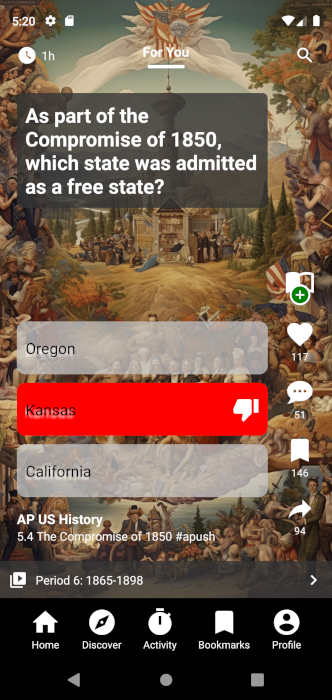

# TeachTok

An application for displaying multiple-choice questions in a TicTok style interface.

**Historical take-home exercise.** This repository preserves a time-boxed demonstration rather than a maintained application. It is not presented as current production-ready architecture or delivery practice.

Made with ♥ in VIM.

## Notes

- clean architecture as a foundation, separation of application layers
- feature based modules ([forYou](src/feature/forYou))
- data flows in one direction from data layer, to domain, to application, to presentation
- redux actions dispatch data flow through the layers
- dependency injection and immutables but left out for now
- use case hooks

### get next question

**design**:

The app maintains an internal cache of prefetched items.

The prefetching is building the internal cache for swiping.

API calls will prefetch using an exponential backoff algorithm.

**process**:

- use cases makes current request for data
- maps the data to the domain layer and preloads the image
- prefetches the next

### time in app

- keeps a counter in redux store
- sets a timer for every minute
- calculates difference
- dispatch redux action to update UI

## Design Flaws

- backend returns a single random result, not idempotent

## Testing

- Automated tests and CI were omitted under the original exercise constraints. That omission is a known quality gap, not a recommendation for current projects.

## Android debug signing

The tracked `android/app/debug.keystore` is a **public, shared development key** also used by example applications. It does not establish release provenance. Only the Android `debug` variant references this key; the `release` variant intentionally remains unsigned until private CI or operator-controlled signing is explicitly configured. Do not publish/distribute builds signed with the repository debug key or treat the presence of a keystore as a newly exposed private release credential.

Run `node --test test/release-signing.test.mjs` to verify this static signing boundary. This does not validate a full Android build, exercise behavior, or the historical exercise's redistribution permissions.
